<div align="center">


# LastLift

### Find the last lift before it fails.

**No prediction. Just the graph.**

[](https://github.com/murthyroshan/LastLift/actions/workflows/ci.yml)
[](https://lastlift.vercel.app)
[](https://lastlift-api.onrender.com/v1/docs)
[](#use-it-from-your-own-agent)
[](https://www.falkordb.com)
[](web/tests/a11y.spec.ts)
[](LICENSE)
[](https://github.com/murthyroshan/LastLift/releases)
[](#judge-it-in-90-seconds)
[](#tracks-entered)

**[Live site](https://lastlift.vercel.app)** · **[Play the walkthrough](https://lastlift.vercel.app/concepts/alewife.html)** · **[API docs](https://lastlift-api.onrender.com/v1/docs)** · **[MCP endpoint](#use-it-from-your-own-agent)** · **[Issues the agent filed](https://github.com/murthyroshan/lastlift-ops/issues)** · Demo video: _link added when recorded_

<br>

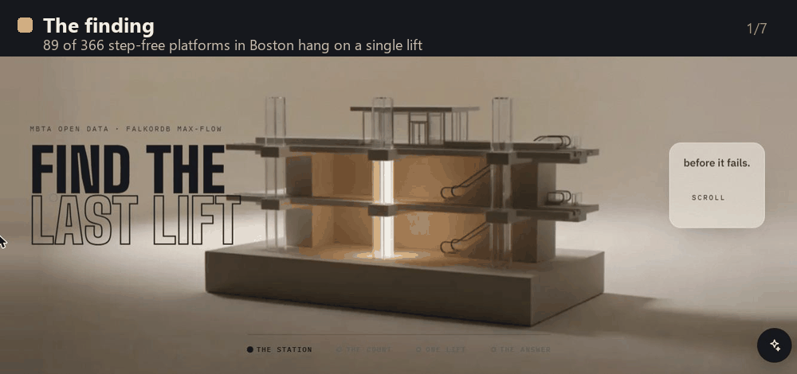

</div>

> Unofficial decision-support prototype. Not affiliated with or endorsed by the MBTA or MassDOT. Uses MBTA GTFS and V3 API data under the MassDOT Developers License Agreement. Data may be incomplete or out of date. Always check mbta.com/alerts/access before travelling. Elevator status line 617-222-2828; customer support 617-222-3200 (TTY 711).
>
> Results describe the open-data model and may differ from conditions on the ground.

## The finding

<table>
<tr>
<td align="center" width="25%"><h1><!--claim:platforms_single_lift-->89<!--/claim--></h1>of <!--claim:platforms_step_free-->366<!--/claim--> step-free platforms in Boston's MBTA station data hang on <b>a single lift</b></td>
<td align="center" width="25%"><h1><!--claim:n2_critical_pairs-->42<!--/claim--></h1>lift pairs are harmless alone but <b>cut platforms off together</b></td>
<td align="center" width="25%"><h1><!--claim:net_spof_lifts-->15<!--/claim--></h1>lifts can each cut <b>a whole station</b> off from the step-free network</td>
<td align="center" width="25%"><h1><!--claim:falkordb_certified-->734<!--/claim--></h1>of <!--claim:maxflow_calls-->734<!--/claim--> FalkorDB max-flow results <b>certified</b> and equal to NetworkX</td>
</tr>
</table>

LastLift turns the MBTA's published station layouts into a flow network in FalkorDB, so for every platform it knows how many lift failures it takes to cut riders who need step-free access off, which lift that is, and what to do when it happens. An agent answers questions about it through tools that any MCP client can call, and operations agents turn a closure into a ticket a person approves.

**Graph Hacks track:** Agents That Act on Connected Data.

### If you have 60 seconds

- Every step-free route through a station is a path through lifts, walkways and fare gates. Give each lift a capacity of one and **max-flow is the number of lifts that must fail before a platform is cut off**. One means a single point of failure.
- Today, with lift 961 closed at Alewife, **lift 813 is newly the only lift** for the Red Line, Track 1 and Track 2 platforms. No alert says that; the graph does.
- <!--claim:naive_two_lifts_but_k1-->74<!--/claim--> of the single-lift platforms are at stations with two or more lifts: counting lifts is not enough.
- Every number is a certified FalkorDB result, cross-checked against NetworkX, and every agent answer cites the exact Cypher it ran.

## See it

<table>
<tr>
<td width="50%">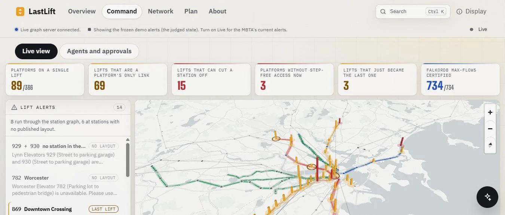<br><b>Command.</b> Every open lift alert, what it means, and a map of the network coloured by MBTA line.</td>
<td width="50%">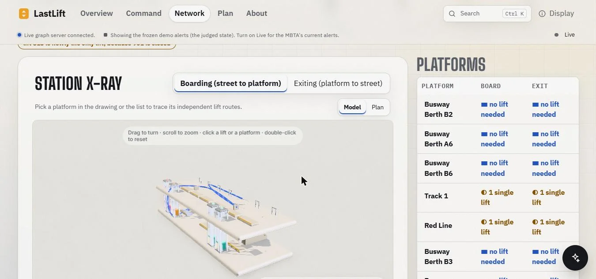<br><b>Station x-ray.</b> Alewife's levels in 3D, every platform's independent lift routes, and the table twin for screen readers.</td>
</tr>
<tr>
<td width="50%">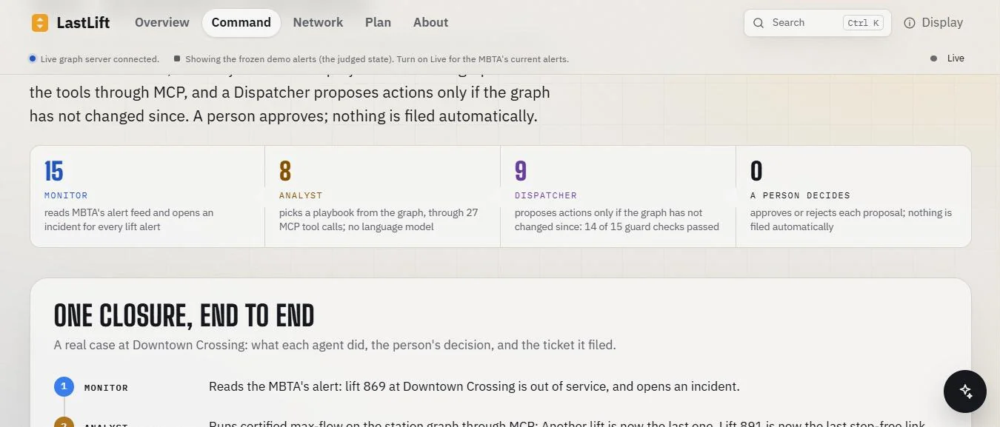<br><b>Operations agents.</b> Monitor, Analyst and Dispatcher work every closure; a person approves before anything is filed.</td>
<td width="50%">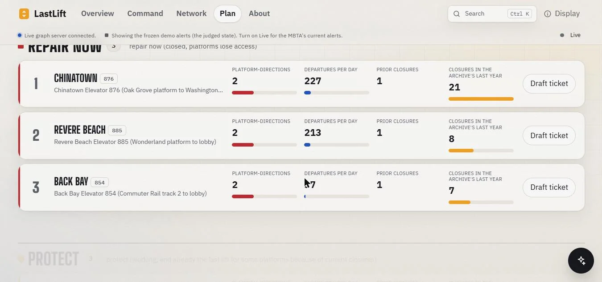<br><b>Plan.</b> Which lifts to repair now, which to protect, and what breaks if you close any three.</td>
</tr>
<tr>
<td width="50%">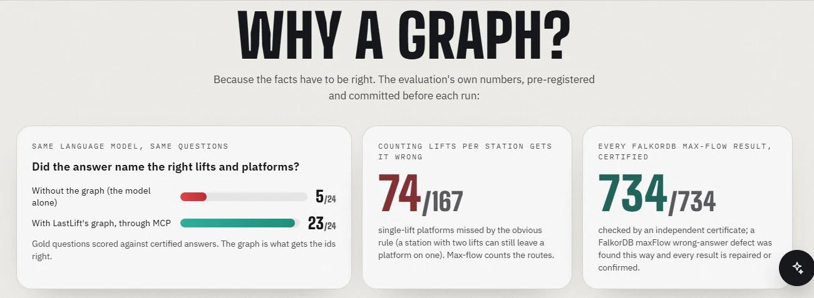<br><b>Why a graph.</b> The evaluation's own numbers on the landing page: the same model with and without the graph, the count-lifts rule, and certification.</td>
<td width="50%">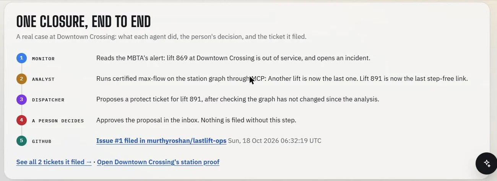<br><b>One closure, end to end.</b> Lift 869 closes at Downtown Crossing; the agents find 891 is now the last lift; a person approves; the issue is filed.</td>
</tr>
<tr>
<td width="50%">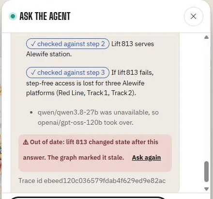<br><b>Answers that expire.</b> Each live answer is checked against the graph while the chat is open, and flips to out of date the moment a lift it read changes.</td>
<td width="50%">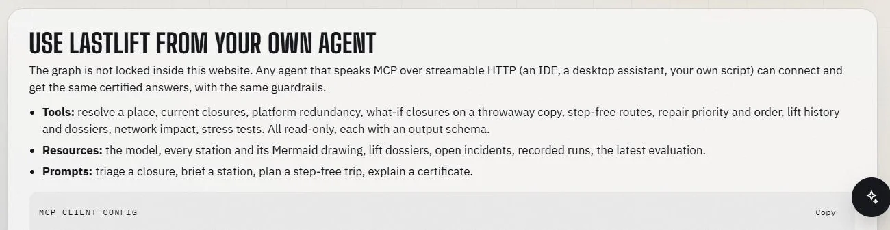<br><b>Bring your own agent.</b> The same tools, resources and prompts over a public MCP endpoint, with a copy-paste client config.</td>
</tr>
<tr>
<td colspan="2"><br><b>Walk through Alewife.</b> A seated first-person walkthrough built from LastLift's own data: lift 961 is closed, then lift 813 fails in front of you. <a href="https://lastlift.vercel.app/concepts/alewife.html">Play it</a>, or <a href="https://lastlift.vercel.app/concepts/alewife.html?autoplay">watch it play itself</a>.</td>
</tr>
</table>

## The agent, grounded in a graph

A recorded run from [`web/public/replay/whatif-813.json`](web/public/replay/whatif-813.json): a language model reaching LastLift's tools only through MCP, every claim in its answer checked against what the tools returned. The website replays it on the landing page and lets you verify its hash chain in the browser.

```text
Q  What happens if lift 813 fails too?

1  resolve_place      query: lift 813                                        via MCP ·   36 ms
   → lift 813 (Alewife Elevator 813 (Platform to main lobby))
2  what_if_close      facility_ids: [813]                                    via MCP · 1070 ms
   → simulated closing 813: 3 more platforms lose step-free access; 0 lifts become the last lift
     (simulation on a copy; live state unchanged)
3  step_free_route    from_station: place-alfcl · to_platform: Red Line
                      also_closed: [813]                                     via MCP ·   67 ms
   → no step-free route in the open-data model

✓  grounded: every claim checked against the tool results

A  If lift 813 fails, the Alewife Red Line platform loses step-free access in the open-data model.
   No step-free route exists in the open-data model to board that platform via other stations.
   Check mbta.com/alerts/access.
```

And the agents act. These two issues were filed by the Dispatcher, after a person approved each proposal, as lift dossiers with a drawing of the station's step-free graph:

| | Issue | Why the graph proposed it |
|---|---|---|
| **Protect** | [lastlift-ops#1: lift 891, Downtown Crossing](https://github.com/murthyroshan/lastlift-ops/issues/1) | Still working, but with 869 closed it is the last lift for the Oak Grove and Alewife platforms (minimum cut {869, 891}) |
| **Repair** | [lastlift-ops#2: lift 885, Revere Beach](https://github.com/murthyroshan/lastlift-ops/issues/2) | Closed, and the Wonderland platform has no other step-free route |

## Answers that know when they are out of date

<p align="center"></p>

An agent's answer is only as good as the context it was built from, and lift status changes by the hour. LastLift keeps that context honest in the graph itself:

- Every chat run is written as `(:Run)-[:CALLED]->(:ToolCall)-[:READ]->(:Lift)` with its `(:Answer)`, tagged with the run's trace id.
- When a lift changes state (`state.sync`), the same step marks every answer that read it `stale`, with the reason. An unrelated answer is untouched.
- `GET /v1/answers/{trace_id}` reports whether an answer is still true. The chat polls it while it is open: "✓ Still true" until a lift it read changes, then "⚠ Out of date: lift 813 changed state after this answer", with **Ask again**.
- To see it happen: ask about Alewife in the chat, then run `python scripts/demo_stale.py close 813` against your own graph; the answer flips within seconds. `python scripts/demo_stale.py restore` puts the closures back exactly as they were.

## Instead of "Elevator out of service", LastLift says what it means for you

| The alert | LastLift |
|---|---|
| "Revere Beach Elevator 885 is unavailable." | The Wonderland platform loses step-free access in the open-data model. To board step-free: lift 884, ride the Blue Line to Beachmont, change platforms there step-free, ride back (about 17 minutes). There is no backup avoiding lifts 884, 886 and 887. |
| "Alewife Elevator 961 is unavailable." | No platform loses access, but lift 813 is now the only lift for three platforms. Protect it. |
| "Elevator 782 at Worcester is unavailable." | Cannot assess: MBTA publishes no station layout for Worcester. |

## How it proves a last lift

<p align="center">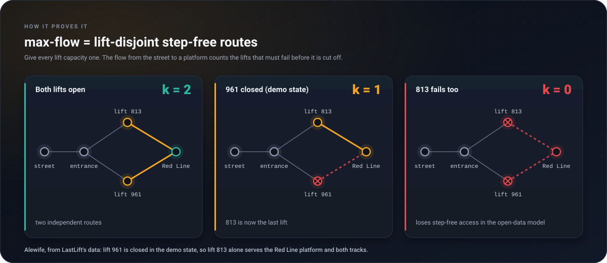</p>

FalkorDB 4.22's `algo.maxFlow` can return a wrong value on some networks: on an 11-edge reproduction it returns 300 where the true max-flow is 453 (reported by the Chokepoint project; reproduced in [`docs/falkordb-maxflow-note.md`](docs/falkordb-maxflow-note.md)). So no FalkorDB flow is trusted on its own:

- each result is certified by checking that the returned flow is a feasible flow whose residual graph has no augmenting path, and repaired with an exact Dinic run if it is not;
- the minimum cut names the lifts; each lift on a single route is removed in turn to find every single point of failure;
- an independent checker validates the k lift-disjoint routes as a proof.

On LastLift's network: <!--claim:maxflow_calls-->734<!--/claim--> max-flow calls, <!--claim:falkordb_first_pass_exact-->734<!--/claim--> certified on the first pass, <!--claim:falkordb_repaired-->0<!--/claim--> repaired, <!--claim:falkordb_eq_networkx-->734<!--/claim--> equal to NetworkX, <!--claim:checker_accepted-->333<!--/claim--> route proofs accepted and <!--claim:checker_rejected-->0<!--/claim--> rejected. `scripts/verify_claims.py` re-derives every headline number from the committed snapshot with NetworkX alone.

The same caution applies to path search: on 4.22 `algo.SPpaths` enumerates paths and ignored the server timeout in our tests, so LastLift routes with Dijkstra over edges read from the graph and re-checks every edge of a route in FalkorDB ([`docs/falkordb-sppaths-note.md`](docs/falkordb-sppaths-note.md)).

## Architecture

<p align="center">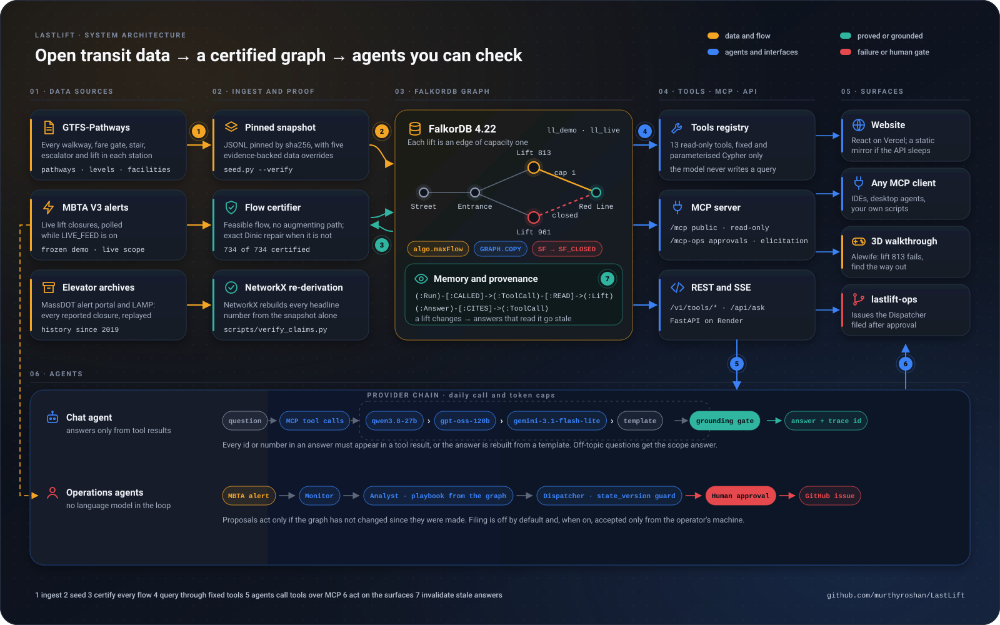</p>

| Layer | What it is | Where |
|---|---|---|
| Data | MBTA GTFS-Pathways, V3 alerts, MassDOT alert archives and LAMP | [`ingest/`](ingest/), [`data/`](data/) |
| Proof | A pinned snapshot, the flow certifier, an independent NetworkX re-derivation | [`lastlift/flow.py`](lastlift/flow.py), [`lastlift/checker.py`](lastlift/checker.py), [`scripts/verify_claims.py`](scripts/verify_claims.py) |
| Graph | FalkorDB 4.22: the step-free network, closures as relationship swaps, what-ifs on `GRAPH.COPY`, memory and provenance | [`lastlift/queries.py`](lastlift/queries.py), [`lastlift/memory.py`](lastlift/memory.py) |
| Tools | Thirteen read-only tools over fixed, parameterised Cypher | [`lastlift/tools.py`](lastlift/tools.py) |
| MCP and API | `/mcp` (public, read-only), `/mcp-ops` (approvals), REST `/v1`, SSE `/api/ask` | [`lastlift/mcp_server.py`](lastlift/mcp_server.py), [`lastlift/main.py`](lastlift/main.py) |
| Agents | A grounded chat agent with a provider chain; Monitor, Analyst and Dispatcher | [`lastlift/agent/`](lastlift/agent/), [`lastlift/agents/`](lastlift/agents/) |
| Surfaces | React and Vite on Vercel (pages open from a snapshot FalkorDB computed; live answers from the graph), the 3D walkthrough, `lastlift-ops` | [`web/`](web/), [`web/public/concepts/alewife.html`](web/public/concepts/alewife.html) |

## Judge it in 90 seconds

**On the site:** [the Judge's tour](https://lastlift.vercel.app/#/tour) walks through everything in seven stops, each one the real thing. **From a terminal:**

1. `POST https://lastlift-api.onrender.com/v1/tools/platform_redundancy` with `{"station_id": "place-alfcl"}`: Alewife, with the lift that became the last lift and why.
2. `POST .../v1/tools/what_if_close` with `{"facility_ids": ["813"]}`: close a working lift on a copy of the graph; three platforms lose step-free access; the live state is untouched.
3. `POST .../api/ask` with `{"question": "Can I get step-free onto the Wonderland-bound platform at Revere Beach right now?"}`: the agent's answer and every tool call it made, via MCP.
4. `GET .../v1/queries`: every Cypher statement LastLift runs.
5. `python scripts/smoke.py --prod` checks all of the above from your machine.

## Every submission requirement, and exactly where it is

| Rule 10 requirement | Where |
|---|---|
| Public source-code repository | this repository |
| README with setup instructions and the graph data model | [Run it yourself](#run-it-yourself), [The graph data model](#the-graph-data-model) |
| The Cypher queries or graph algorithms the product depends on | [The Cypher and the algorithms](#the-cypher-and-the-algorithms) (generated from `lastlift/queries.py`) |
| A demo video | _added when recorded_ |
| A live deployment, or complete local setup | https://lastlift.vercel.app, https://lastlift-api.onrender.com and [Run it yourself](#run-it-yourself) |
| The tracks | Track 1, Agents That Act on Connected Data; Track 2, Agent Memory and Coordination ([why both](#tracks-entered)) |

### Tracks entered

- **Track 1, Agents That Act on Connected Data.** Operations agents act on the graph: the Monitor reads live MBTA alerts, the Analyst picks a playbook from certified max-flow, the Dispatcher proposes only while the graph is unchanged, and a person's approval files a real ticket ([lastlift-ops](https://github.com/murthyroshan/lastlift-ops/issues)). The chat agent answers only through the tools, over MCP, with every claim checked.
- **Track 2, Agent Memory and Coordination.** The agents' memory lives in FalkorDB: every run, tool call and answer is a node with what it read; an answer is marked stale the moment a lift it read changes ([Answers that know when they are out of date](#answers-that-know-when-they-are-out-of-date)); the agents coordinate by writing assessments and proposals into the graph, guarded by its state version, never by messaging each other.

Rule 3 (the graph does real work): see [Turn FalkorDB off](#turn-falkordb-off-and-here-is-exactly-what-stops-working). Rule 6 (data you may use): public MBTA open data only. Rule 11 (AI disclosure): [AI assistance](#ai-assistance).

## One closed lift, seen across the whole network

A lift can cut a platform off, yet riders may still ride a train to another station and back. So LastLift also asks the network question: which journeys between stations does a closure break?

- **<!--claim:net_platform_spof_lifts-->69<!--/claim--> lifts can each cut a platform off on their own; only <!--claim:net_spof_lifts-->15<!--/claim--> can cut a whole station off from the step-free network** (<!--claim:net_cut_off_stations-->13<!--/claim--> stations; each such closure breaks <!--claim:net_spof_journeys_each-->176<!--/claim--> of the <!--claim:net_od_pairs-->7,832<!--/claim--> journeys between the <!--claim:net_origins-->89<!--/claim--> stations with an accessible entrance). For the other <!--claim:net_rescued_lifts-->54<!--/claim--> the network re-routes riders: median worst detour <!--claim:net_detour_median_min-->11<!--/claim--> min, longest <!--claim:net_detour_max_min-->20.2<!--/claim--> min.
- **How:** dominator trees. Every lift is node-split, so closing it deletes one node; the journeys it breaks from an origin are exactly the stations in that node's dominator subtree. One tree per origin (Cooper-Harvey-Kennedy, on the network contracted to its lift-free strongly connected parts) gives the whole N-1 table in a fraction of a second. A plain search with each lift removed agrees for <!--claim:net_dominator_eq_witness-->198<!--/claim--> of <!--claim:net_dominator_lifts-->198<!--/claim--> lifts, and the tests apply closures in FalkorDB with Cypher and re-read the graph to confirm it.
- **Conditional last lifts:** with one lift closed, its partner can become the only link between a station and the network. There are <!--claim:net_conditional_pairs-->42<!--/claim--> such pairs, and <!--claim:net_conditional_cross_station-->0<!--/claim--> of them span two stations: in the open data the turnaround stations always have a spare. In the demo state, lift 885 is closed, so 884 alone now links Revere Beach to every other station.
- **Critical pairs (N-2):** <!--claim:n2_critical_pairs-->42<!--/claim--> lift pairs are each harmless alone but cut platforms off together; the worst is <!--claim:n2_top_pair-->821+973<!--/claim--> (<!--claim:n2_top_pair_dirs-->18<!--/claim--> platform-directions). Each pair is re-checked in FalkorDB: max-flow 0 with both closed, above 0 with either alone.
- **Every minimum cut, not just one:** for each of the <!--claim:mincut_dirs-->333<!--/claim--> lift-dependent platform-directions, all minimum cuts come from the certified flow's residual graph (Picard-Queyranne); <!--claim:mincut_pq_eq_brute-->333<!--/claim--> equal a brute-force search over every set of lifts, and <!--claim:mincut_multi-->71<!--/claim--> have more than one.
- **Exact reliability:** no platform depends on more than twelve lifts, so the chance of losing access when each lift is out with probability q is computed exactly by enumeration (the station page has a slider). With every lift out <!--claim:rel_q_assumed-->2%<!--/claim--> of the time, about <!--claim:net_mc_reachable_q02-->99%<!--/claim--> of journeys between stations stay step-free (Monte-Carlo, seeded).
- **Repair order:** for the lifts closed now, the order that gives back the most soonest is computed exactly (dynamic programming over subsets) and compared with greedy.
- **Query plans:** `GET /v1/queries/{id}/plan?mode=explain|profile` returns FalkorDB's own plan (profiles run on a private copy; write queries are refused); examples are in [`docs/profiles/`](docs/profiles/).

The Silver Line (SL1-SL5) counts as a ride in this analysis (model rules version 2): Courthouse and World Trade Center are reachable step-free only by it.

## Seven years of closures, replayed through the graph

MBTA keeps no lift-outage history of its own, but MassDOT publishes every service alert, and MBTA's LAMP archive goes back to 2019. LastLift replays every reported elevator closure since 1 January 2024 through today's step-free graph ([`validation/HISTORY.md`](validation/HISTORY.md)):

- **<!--claim:hist_dirs_lost-->285<!--/claim--> platform-directions lost step-free access at least once**, for <!--claim:hist_lost_service_h-->58,286<!--/claim--> platform-direction hours within scheduled service; <!--claim:hist_single_share-->93%<!--/claim--> of those hours trace to a single lift. Redundancy was defeated (two or more lifts out together) <!--claim:hist_concurrent_losses-->390<!--/claim--> times.
- The costliest single lift was <!--claim:hist_top_lift-->811<!--/claim--> (<!--claim:hist_top_lift_service_h-->6,994<!--/claim--> service hours). Each lift's availability, closures and median closure length are in the graph (`(:Outage)-[:OF]->(:Lift)`) and in the agent's `lift_history` tool.
- **The certified k explains real exposure:** single-lift platform-directions lost access in <!--claim:hist_bt_k1_month_share-->47%<!--/claim--> of months, those with two or more lift routes in <!--claim:hist_bt_k2_month_share-->6%<!--/claim-->.
- **What history cannot do (a negative result we publish):** ranking lifts by their 2024 record does not pick out the lifts that cost the most in 2025 (Spearman <!--claim:hist_bt_spearman-->0.17<!--/claim--> over <!--claim:hist_bt_lifts-->69<!--/claim--> lifts, precision of the top ten <!--claim:hist_bt_p10-->0.1<!--/claim-->), and a monthly closure model fails the calibration bar set in advance (Brier skill <!--claim:hist_bt_brier_skill-->0.084<!--/claim-->). So LastLift shows historical frequencies and never a failure forecast.
- With each lift's own outage rate instead of a uniform guess, <!--claim:rel_emp_dirs_over_5pct-->20<!--/claim--> platform-directions would be without step-free access more than 5% of the time.
- Checks: 20 random moments of the replay re-checked with FalkorDB's certified max-flow on a copy of the graph; totals reproduce from the committed files in the tests; a sensitivity table (imputed ends in or out, episode gaps of 0, 30 and 120 minutes, calendar or service hours); the 2025 total from the portal alone reproduces the planning probe within 1%, and the sources are compared side by side. The portal's timestamps turned out to be Boston local time labelled as UTC; the history reads them as local time.

## Checked against the operator's own words

Fourteen live MBTA lift alerts were labelled blind by the author, from MBTA's alert text only, before the evaluation ran ([`validation/`](validation/)). Of the <!--claim:live_scored-->8<!--/claim--> that both the author and the model could assess: **<!--claim:live_agree-->6<!--/claim--> agree, <!--claim:live_partial-->2<!--/claim--> partial, <!--claim:live_disagree-->0<!--/claim--> disagree** (agreement interval <!--claim:live_agree_wilson95-->41%, 93%<!--/claim-->, Wilson 95%). **False accessible: <!--claim:live_false_accessible-->1<!--/claim--> (<!--claim:live_false_accessible_cases-->L04 board<!--/claim-->)**: for State 803 MBTA sends riders to Downtown Crossing, while the open data holds a longer in-station route; LastLift shows both and tells riders to follow MBTA's advice. The model abstains where MBTA publishes no layout (unknown rate <!--claim:live_unknown_rate-->6/14<!--/claim-->). Every row, including every disagreement, is in [`validation/EVALUATION.md`](validation/EVALUATION.md). A second sweep over the alternative-service text of every MBTA elevator is labelled by the author before it is scored (<!--claim:static_sweep_status-->awaiting author review (69 of 215 rows flagged)<!--/claim-->).

## Measured: the agent with and without the graph

Thirty questions in eight categories were committed before any run ([`eval/protocol.md`](eval/protocol.md), [`eval/gold_questions.yaml`](eval/gold_questions.yaml)), scored deterministically with Wilson intervals (`eval/run.py`). Free-tier limits forced two documented amendments: run 1 was rate-limited, and in run 2 the planned model (qwen) had reached its daily token cap, so run 3 puts both arms of the ablation on one model, `gemini-3.1-flash-lite`. Every run is published; the corrections are in [`eval/gold_errata.md`](eval/gold_errata.md).

<!--generated:eval-->
| System | Right tools | Gold ids | Verdicts | False accessible | Abstains when it must | Forbidden claims | Template fallback | Models |
|---|---|---|---|---|---|---|---|---|
| Run 3: full agent (MCP tools + grounding), gemini-3.1-flash-lite | 21/30 | 23/24 | 5/7 | 2 | 1/3 | 2 | 13/30 | gemini-3.1-flash-lite |
| Run 3: same model, no graph (FalkorDB off) | – | 5/24 | 4/7 | 2 | 1/3 | 0 | 0/30 | gemini-3.1-flash-lite |
| Router + templates (no LLM) | 27/30 | 22/24 | 7/7 | 0 | 1/3 | 0 | – | – |
| Run 2: full agent (qwen at its daily cap; see amendment 2) | 25/30 | 24/24 | 7/7 | 0 | 1/3 | 0 | 11/30 | openai/gpt-oss-120b |
| Run 2: fallback subset, 12 q | 9/12 | 6/8 | 2/4 | 2 | 1/1 | 2 | 5/12 | gemini-3.1-flash-lite |
| Run 1: full agent (rate-limited; amendment 1) | 25/30 | 23/24 | 7/7 | 0 | 1/3 | 0 | 8/30 | openai/gpt-oss-120b, qwen/qwen3.8-27b |
| Run 1: fallback subset (rate-limited) | 10/12 | 8/8 | 4/4 | 0 | 0/1 | 0 | 6/12 | openai/gpt-oss-120b |
<!--/generated-->

- **The graph is what gets the facts right:** with the tools, the right lift and platform ids appear in <!--claim:eval_full_gemini_ids-->23/24<!--/claim--> answers; the same model without the graph manages <!--claim:eval_llm_only_gemini_ids-->5/24<!--/claim-->.
- **Nothing ungrounded is shipped:** <!--claim:eval_full_gemini_raw_ungrounded-->8/25<!--/claim--> raw model answers failed the grounding validator and were replaced by the template built from the tool results (<!--claim:eval_full_gemini_fallback_to_template-->13/30<!--/claim--> template answers in all). The router alone (no language model) gets <!--claim:eval_router_verdicts-->7/7<!--/claim--> verdicts with <!--claim:eval_router_false_accessible-->0<!--/claim--> false-accessible answers.
- **Where the small model still fails:** <!--claim:eval_full_gemini_false_accessible-->2<!--/claim--> false-accessible counts in run 3 come from one answer (Q01) that offered the ride-and-return route without saying the platform loses step-free access; it is listed, not hidden. Its <!--claim:eval_full_gemini_forbidden-->2<!--/claim--> forbidden-claim hits are a gold error (Q25 assumed lift 999 does not exist; it is at Downtown Crossing, and the answer said so correctly; errata E1). Abstaining on unmodelled lifts is the weakest category for every system (<!--claim:eval_full_gemini_abstain_must-->1/3<!--/claim-->).
- **Baselines without max-flow:** counting lifts per station misses <!--claim:eval_bcount_wrong-->74<!--/claim--> of <!--claim:eval_bcount_platforms-->167<!--/claim--> single-lift platforms. A language model reading a small station's raw `pathways.txt` does well: k exactly right in <!--claim:eval_bllm_k-->27/30<!--/claim--> and the cut in <!--claim:eval_bllm_cut-->26/30<!--/claim--> (stations up to 150 pathway rows), so the graph's advantage there is certification, scale and what-ifs, not raw reading.

## Turn FalkorDB off, and here is exactly what stops working

Everything LastLift computes is computed in FalkorDB: redundancy (`algo.maxFlow` on the step-free subgraph), closures (relationship-type swaps `SF` → `SF_CLOSED`), what-ifs (`GRAPH.COPY` of the live graph, closures applied to the copy), incident memory (`Incident` nodes linked to lifts), the repair ranking (`DEPENDS_ON` / `DEPENDS_NOW` relationships), the station drawings and the route certificates. Stop the database and:

- `/healthz` returns 503 and every tool and the agent answer 503 `graph_unavailable`, never a guess (tested in `tests/test_memory.py`);
- no what-if, reroute, ranking or answer can be produced;
- the website falls back to a frozen copy of the demo state that FalkorDB computed earlier, and says so.

## The agent acts through the same tools as everyone

- Thirteen tools ([`lastlift/tools.py`](lastlift/tools.py)): `resolve_place`, `current_closures`, `platform_redundancy`, `what_if_close`, `step_free_route`, `repair_priority`, `lift_history`, `draft_action`, `network_impact`, `repair_order`, `recall_lift_history`, `lift_dossier`, `stress_test`. The LLM never writes Cypher; every tool runs fixed, parameterised queries and reports their ids.
- The agent reaches the tools **only through MCP** (an in-memory MCP client; a test breaks every direct path and the agent still answers).
- Every answer is grounded: an id or number that is not in a tool result, or wording our copy rules forbid, sends the answer back to a deterministic template built from the tool results.
- Repair priority ranks lifts to repair now (closed, platforms cut off), to protect (working, but newly the last lift) and structural single points of failure; `draft_action` drafts a ticket and never files it.
- Providers fail over in a fixed chain: Groq `qwen/qwen3.8-27b`, then `openai/gpt-oss-120b`, then Gemini `gemini-3.1-flash-lite`, then the template. Each switch appears in the run's trace, the answer names the model that wrote it, and a daily token budget (counted from the providers' usage figures) stops LLM calls before the free quotas run out. A fault-injection test (`tests/test_chain.py`) fails each tier in turn.
- Every run has a W3C trace id (send a `traceparent` header to join your own trace); each tool call has its own span id, and LLM calls are logged with OpenTelemetry GenAI attribute names (`gen_ai.system`, `gen_ai.request.model`, `gen_ai.usage.input_tokens`, `gen_ai.usage.output_tokens`).
- Seven recorded runs in `web/public/replay/` re-execute against the graph in CI (`scripts/verify_replays.py`): a recorded fact that no longer matches the graph fails the build.

## Operations agents: no language model in the critical path

<p align="center"></p>

Three roles in one process act on every lift closure ([`lastlift/agents/`](lastlift/agents/)), handing off by writing nodes so every decision can be read back in Cypher:

- **Monitor** reads MBTA's alerts. **Analyst** chooses a playbook from graph facts (lift not modelled: *abstain*; a platform-direction's k went to 0: *access lost*; another lift became the last one: *preventive*; otherwise *no loss*; a lift in the top quarter of closures in the archive's last year adds *chronic*, so memory changes the action), calls the tools through MCP and writes `(:Assessment)-[:ABOUT]->(:Lift)`. **Dispatcher** proposes actions from a fixed policy table, and only if a Cypher guard confirms the assessment was made at the graph's current `state_version`: a stale belief cannot act.
- Policy: repair and protect tickets need a person's approval (website inbox, `POST /v1/approvals/{id}` with an `Idempotency-Key`, or MCP elicitation on `/mcp-ops`); approved tickets become GitHub issues on the ops repository only when filing is switched on, as a lift dossier with a Mermaid drawing of the station, deduplicated per lift. Rider notices ("follow a station" in the free ntfy app; no subscriber data stored) go out automatically only when notifications are switched on, once per change of state.
- No language model is given a write tool, so text in an alert (a prompt injection included) cannot cause an action; a test checks it.
- Memory and provenance: every chat run is recorded as `(:Run)-[:CALLED]->(:ToolCall)-[:READ]->(:Lift|:Platform|:Station)` with its `(:Answer)`; when a lift changes state, the answers that read it are marked stale in the same step. `recall_lift_history` and `lift_dossier` read it back. Memory means observed history and provenance; nothing is learned.
- Recorded runs are hash-chained: the website's "Verify this replay" button recomputes the chain in the browser, and one edited byte fails.

## Use it from your own agent

Point any MCP client that supports streamable HTTP at the endpoint:

```json
{ "mcpServers": { "lastlift": { "url": "https://lastlift-api.onrender.com/mcp/" } } }
```

All thirteen tools are read-only (`readOnlyHint`), with an output schema; `what_if_close` works on a throwaway copy. The server also offers resources (`lastlift://model`, `lastlift://stations/{id}` and its Mermaid drawing `graph.mmd`, `lastlift://lifts/{id}/dossier.md`, `lastlift://incidents/open`, `lastlift://runs/{id}`, `lastlift://eval/latest`) and prompts (`triage_closure`, `station_briefing`, `plan_step_free_trip`, `explain_certificate`). The free host sleeps when idle, so the first call may take a minute.

The same block works in Cursor (`.cursor/mcp.json`), VS Code and desktop agents that speak MCP; they then see LastLift's tools, resources and prompts alongside their own.

Or straight over HTTP:

```sh
# Which Alewife platforms hang on one lift, and why
curl -s -X POST https://lastlift-api.onrender.com/v1/tools/platform_redundancy \
  -H 'Content-Type: application/json' -d '{"station_id": "place-alfcl"}'

# Close a working lift on a throwaway copy of the graph
curl -s -X POST https://lastlift-api.onrender.com/v1/tools/what_if_close \
  -H 'Content-Type: application/json' -d '{"facility_ids": ["813"]}'

# Ask the agent; the reply carries every tool call it made and a trace id
curl -s -X POST https://lastlift-api.onrender.com/api/ask \
  -H 'Content-Type: application/json' -d '{"question": "What happens if lift 813 fails too?"}'
```

## Does it travel? The Step-Free Atlas

The same rules, with no agency-specific handling, run on every transit agency that publishes GTFS-Pathways with open access in the Mobility Database catalogue: 14 feeds, of which 10 model their lifts well enough to assess. Only the needed files are fetched, by HTTP range reads on each zip ([`ingest/atlas_fetch.py`](ingest/atlas_fetch.py)). Every lift-dependent platform-direction is solved exactly in Python and again with FalkorDB's `algo.maxFlow` in a temporary graph that is deleted afterwards: 2884 of 2884 agree ([`scripts/atlas_sweep.py`](scripts/atlas_sweep.py)). Run on the MBTA's feed, the generic rules give the same 89 single-lift platforms as LastLift's own model. Each agency gets a data-readiness grade; agencies are named on the site only after their data licence has been checked ([`data/atlas_licences.json`](data/atlas_licences.json)).

## Walk through Alewife

[`/concepts/alewife.html`](https://lastlift.vercel.app/concepts/alewife.html) is a seated first-person walkthrough of a platform like Alewife's, built in three.js from photo-scanned CC0 materials and a real metro HDRI (credits in [`web/public/world/CREDITS.md`](web/public/world/CREDITS.md)). The station is drawn for the game; the lifts, the closure and the numbers on its results screens come from LastLift's data.

- **Mission 1:** the train pulls out; lift 961 is taped off; find lift 813 and ride it up.
- **Mission 2:** lift 813 fails in front of you. With both lifts out there is no step-free way off the platform, and the only way out is the train back to Davis.
- W and S roll, A and D turn, the mouse looks, E uses; touch controls on phones. Add `?autoplay` to watch mission 2 play itself.

## Built for the people it is about

- Every state is shown as a glyph, a number and a word, never colour alone; "good" is blue, never green.
- The station drawing is decorative for assistive technology; the platform, lift and route tables say the same in words.
- Hear it: a station's routes play as a chord (one tone per independent route, a trembling tone when one lift is left), and "Hear a line" plays a whole line station by station; every sound has a text twin and nothing plays before you press play.
- Atkinson Hyperlegible type, a two-tone focus ring, 44-pixel targets, reflow at 320 pixels, reduced-motion and forced-colours support.
- CI runs axe on every core screen in light and dark themes with the API blocked, plus keyboard-only and 320-pixel checks (`web/tests/a11y.spec.ts`).
- Wording rules and exact disclaimers are enforced by a lint ([`lastlift/wording.py`](lastlift/wording.py)); see [`docs/ETHICS.md`](docs/ETHICS.md). Not yet reviewed by disabled riders; designed for that review.

## Security and safeguards

- **Agents cannot act on their own.** No language model is given a write tool. Repair and protect tickets need a person's approval with an `Idempotency-Key`; filing is off by default (`ACTIONS_MODE=draft`) and, when switched on, accepted only from the operator's own machine.
- **Stale beliefs cannot act.** A proposal goes through only if the graph's `state_version` has not changed since it was made.
- **Grounding gate.** An id or number in an answer that is not in a tool result sends the answer back to a template built from the tool results; questions about anything but step-free access get the scope answer.
- **Spend caps.** Daily LLM call and token budgets; past them the agent answers from templates.
- **Website headers** ([`web/vercel.json`](web/vercel.json)): a content security policy that allows the app's own scripts only, HSTS, `nosniff`, a strict referrer policy and a permissions policy. The browser tests run under the same headers.
- **Secrets** live only in the environment; a pre-commit and pre-push scan ([`scripts/secret_scan.py`](scripts/secret_scan.py)) blocks keys, wrong authors and banned wording.

## Tests and quality

| Check | What it proves |
|---|---|
| `pytest` | Tools, agents, approvals, MCP surface, memory, recorded runs, the evaluation reproducing byte for byte, README and claims |
| Playwright (`web/tests/`) | 34 browser tests: every page from FalkorDB's precomputed snapshot with the API blocked, axe in light and dark at 320 and 1280 pixels, keyboard-only use, eyes-free mode |
| `scripts/verify_claims.py` | Every headline number re-derived from the snapshot with NetworkX alone |
| `scripts/verify_replays.py` | Recorded agent runs re-executed against the graph; a stale fact fails the build |
| `scripts/readme_sync.py --check` | Every number in this README comes from `claims.json`, every table from the code |
| `scripts/copy_lint.py` | No user-facing text says what LastLift cannot know |

## The graph data model

<p align="center">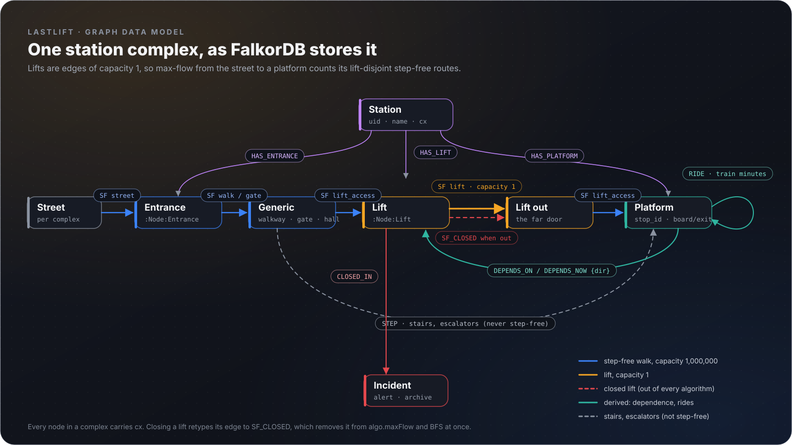</p>

Every node in a station complex carries `cx`; step-free walkways, gates and lift-access edges have capacity 1,000,000 and lift edges capacity 1, so a platform's max-flow from its station's street node is its number of lift-disjoint step-free routes. A closed lift's edge is retyped `SF_CLOSED`, which takes it out of every algorithm at once. Model rules, including five evidence-backed overrides of the published data, are in [`docs/model_rules.md`](docs/model_rules.md).

<!--generated:counts-->
| Node labels | Count |
|---|---|
| `Lift` | 42 |
| `Node:Entrance` | 330 |
| `Node:Generic` | 1,924 |
| `Node:Lift` | 202 |
| `Node:LiftOut` | 202 |
| `Node:Platform` | 388 |
| `Node:Street` | 89 |
| `Platform` | 312 |
| `Station` | 276 |

| Relationship | Count |
|---|---|
| `HAS_ENTRANCE` | 330 |
| `HAS_LIFT` | 244 |
| `HAS_PLATFORM` | 388 |
| `RIDE` | 650 |
| `SF` | 9,248 |
| `STEP` | 1,069 |

| Step-free (`SF`) edge kind | Count |
|---|---|
| `gate` | 274 |
| `lift` | 202 |
| `lift_access` | 856 |
| `street` | 424 |
| `walk` | 7,492 |

Snapshot `2026-10-15`, GTFS feed "Fall 2026, 2026-10-14T18:47:38+00:00, version D", seed sha256 `8277887f216a…`: 3,765 nodes, 11,929 relationships.
<!--/generated-->

<a id="the-cypher-and-the-algorithms"></a>

<details>
<summary><b>The Cypher and the algorithms</b>: every statement LastLift runs</summary>

FalkorDB algorithms used: `algo.maxFlow` (redundancy, certified), `algo.WCC` (load verification), full-text index (station search), `GRAPH.COPY` (what-ifs). Every statement LastLift runs, generated from [`lastlift/queries.py`](lastlift/queries.py):

<!--generated:cypher-->
| Query | Cypher |
|---|---|
| `Q_CLEAR_DEPENDS_NOW` | `MATCH (p:Node:Platform {cx:$cx})-[d:DEPENDS_NOW]->() DELETE d` |
| `Q_CLEAR_INCIDENTS` | `MATCH (i:Incident) DETACH DELETE i` |
| `Q_CLOSED_AT_COMPLEX` | `MATCH (l:Lift {cx:$cx})-[:SF_CLOSED]->() RETURN collect(DISTINCT l.facility_id)` |
| `Q_CLOSED_FACILITIES` | `MATCH (i:Lift)-[:SF_CLOSED]->() RETURN collect(DISTINCT i.facility_id)` |
| `Q_CLOSE_LIFTS` | `UNWIND $fids AS fid MATCH (i:Lift {facility_id:fid})-[r:SF {kind:'lift'}]->(o) CREATE (i)-[c:SF_CLOSED]->(o) SET c = properties(r), i.closed = true DELETE r RETURN count(c)` |
| `Q_COMPLEX_FLOW_EDGES` | `MATCH (a:Node {cx:$cx})-[e:SF]->(b:Node) RETURN e.eid, a.uid, b.uid, e.cap, e.kind, e.facility_id` |
| `Q_COMPLEX_PLATFORMS` | `MATCH (p:Node:Platform {cx:$cx}) RETURN p.stop_id, collect(p.uid), head(collect(p.name)), head(collect(p.wheelchair_boarding)), head(collect(p.platform_name))` |
| `Q_COMPLEX_STREETS` | `MATCH (s:Street {cx:$cx}) RETURN collect(s.uid)` |
| `Q_CONDITIONAL` | `MATCH (a:Node:Lift)-[c:CRITICAL_PAIR]->(b:Node:Lift) WHERE c.scope = 'network' RETURN a.facility_id, b.facility_id, b.station_id, c.journeys, c.same_station ORDER BY c.journeys DESC, a.facility_id, b.facility_id` |
| `Q_CREATE_DEPENDS` | `UNWIND $rows AS r MATCH (p:Node:Platform) WHERE p.stop_id = r.stop MATCH (l:Node:Lift {{facility_id:r.fid, cx:p.cx}}) MERGE (p)-[d:{rel} {{dir:r.dir}}]->(l)` |
| `Q_CRITICAL_PAIRS` | `MATCH (a:Node:Lift)-[c:CRITICAL_PAIR]->(b:Node:Lift) WHERE c.scope = 'platform' RETURN a.facility_id, b.facility_id, a.station_id, c.n, c.dirs ORDER BY c.n DESC, a.facility_id, b.facility_id` |
| `Q_DOMINATES_FOR` | `MATCH (l:Node:Lift {facility_id:$fid})-[:DOMINATES_FOR]->(s:Station) RETURN collect(DISTINCT s.uid)` |
| `Q_LIFT_BLAST` | `MATCH (l:Node:Lift) WHERE l.facility_id IN $fids WITH l.facility_id AS fid, head(collect(l)) AS l RETURN fid, l.name, l.station_id, l.od_cut_base, l.od_cut_off, l.od_slow_base, l.detour_max_s, l.detour_mean_s ORDER BY fid` |
| `Q_LIFT_COMPLEXES` | `MATCH (l:Node:Lift) WHERE l.facility_id IN $fids RETURN collect(DISTINCT l.cx)` |
| `Q_LIFT_HISTORY` | `MATCH (l:Lift {facility_id:$fid})-[:CLOSED_IN]->(i:Incident) RETURN DISTINCT i.alert_id, i.effect, i.header, i.started, i.first_seen, i.last_seen, i.ongoing, i.ended_by, i.versions ORDER BY i.first_seen` |
| `Q_LIFT_INCIDENT_COUNT` | `MATCH (l:Lift {facility_id:$fid}) OPTIONAL MATCH (l)-[:CLOSED_IN]->(i:Incident) RETURN count(DISTINCT i)` |
| `Q_LIFT_INFO` | `MATCH (l:Lift {facility_id:$fid}) RETURN l.facility_id, l.name, l.short_name, l.station_id, l.cx, l.modelled, coalesce(l.closed, false) LIMIT 1` |
| `Q_LIFT_RECORD` | `MATCH (l:Lift) WHERE l.facility_id = $fid WITH l ORDER BY l.uid LIMIT 1 OPTIONAL MATCH (o:Outage)-[:OF]->(l) RETURN l.avail_12m, l.closed_h_12m, l.outages_12m, l.mttr_h, l.single_svc_h, count(o), sum(o.hours), max(o.end), sum(CASE WHEN o.imputed THEN 1 ELSE 0 END)` |
| `Q_LOST_NOW` | `MATCH (p:Node:Platform) WHERE (p.k_board = 0 AND (p.k_board_base > 0 OR p.at_grade_board)) OR (p.k_exit = 0 AND (p.k_exit_base > 0 OR p.at_grade_exit)) RETURN p.stop_id, p.name, p.platform_name, p.station_id, p.k_board, p.k_exit, p.deps_day` |
| `Q_MAXFLOW` | `MATCH (s:Node) WHERE s.uid IN $src WITH collect(s) AS S MATCH (t:Node) WHERE t.uid IN $dst WITH S, collect(t) AS T CALL algo.maxFlow({sourceNodes:S, targetNodes:T, relationshipTypes:['SF'], capacityProperty:'cap'}) YIELD edges, edgeFlows, maxFlow RETURN [e IN edges \| e.eid], edgeFlows, maxFlow` |
| `Q_META` | `MATCH (m:Meta) RETURN m.snapshot_id, m.seed_sha256 LIMIT 1` |
| `Q_MODELLED_LIFTS` | `MATCH (l:Node:Lift) WHERE l.facility_id IN $fids RETURN collect(DISTINCT l.facility_id)` |
| `Q_NETWORK_SPOF` | `MATCH (l:Node:Lift) WHERE l.od_cut_base > 0 WITH l.facility_id AS fid, head(collect(l)) AS l RETURN fid, l.name, l.station_id, l.od_cut_base, l.od_cut_off ORDER BY l.od_cut_base DESC, fid` |
| `Q_NEWLY_LAST` | `MATCH (p:Node:Platform)-[n:DEPENDS_NOW]->(l:Lift) WHERE NOT (p)-[:DEPENDS_ON {dir:n.dir}]->(l) RETURN l.facility_id, l.name, l.station_id, collect(DISTINCT p.stop_id + ' ' + n.dir)` |
| `Q_PAIR_OVERLAP` | `MATCH (x:Outage)-[:OF]->(a:Lift {facility_id:$a}) MATCH (y:Outage)-[:OF]->(b:Lift {facility_id:$b}) WHERE x.start < y.end AND y.start < x.end RETURN count(*), collect([CASE WHEN x.start > y.start THEN x.start ELSE y.start END, CASE WHEN x.end < y.end THEN x.end ELSE y.end END])[0..20]` |
| `Q_PLATFORM_CUTS` | `MATCH (p:Node:Platform {cx:$cx}) RETURN p.stop_id AS stop, head(collect(p.mincuts_board)), head(collect(p.mincuts_exit)), head(collect(p.rel_counts_board)), head(collect(p.rel_counts_exit)), head(collect(p.rel_relevant_board)), head(collect(p.rel_relevant_exit)) ORDER BY stop` |
| `Q_PRIORITY` | `MATCH (p:Node:Platform)-[d:DEPENDS_NOW]->(l:Lift) OPTIONAL MATCH (p)-[o:DEPENDS_ON]->(l) WHERE o.dir = d.dir WITH l, p, d, count(o) AS before WITH l, count(DISTINCT p.stop_id + d.dir) AS deps, sum(p.deps_day) AS departures, toInteger(sum(CASE WHEN before = 0 THEN 1 ELSE 0 END)) AS newly OPTIONAL MATCH (l)-[:CLOSED_IN]->(i:Incident) WITH l, deps, departures, newly, count(DISTINCT i) AS incidents RETURN l.facility_id, l.name, l.station_id, coalesce(l.closed, false), deps, newly, departures, incidents` |
| `Q_REACHES_FROM` | `MATCH (a:Station {uid:$sid})-[r:REACHES]->(b:Station) RETURN b.uid, b.name, r.base_s ORDER BY r.base_s, b.uid` |
| `Q_REOPEN_LIFTS` | `MATCH (i:Lift)-[r:SF_CLOSED]->(o) WHERE NOT i.facility_id IN $fids CREATE (i)-[c:SF]->(o) SET c = properties(r), i.closed = false DELETE r RETURN count(c)` |
| `Q_ROUTE_CHECK_RIDE` | `UNWIND $pairs AS p MATCH (a:Platform {uid:p[0]})-[e:RIDE]->(b:Platform {uid:p[1]}) RETURN a.uid, b.uid, e.wt` |
| `Q_ROUTE_CHECK_SF` | `UNWIND $pairs AS p MATCH (a:Node {uid:p[0]})-[e:SF]->(b:Node {uid:p[1]}) RETURN a.uid, b.uid, e.wt` |
| `Q_ROUTE_EDGES` | `MATCH (a)-[e:SF\|RIDE]->(b) RETURN a.uid, b.uid, e.eid, type(e), e.kind, e.wt, e.facility_id, e.routes` |
| `Q_ROUTE_NODES` | `MATCH (n) WHERE n:Node OR n:Platform RETURN n.uid, labels(n), n.name, n.station_id, n.platform_name, n.short_name` |
| `Q_SET_PLATFORM_NOW` | `MATCH (p:Node:Platform) WHERE p.stop_id = $stop SET p.k_board = $kb, p.k_exit = $ke, p.at_grade_board_now = $ab, p.at_grade_exit_now = $ae, p.cut_board_now = $cb, p.cut_exit_now = $ce` |
| `Q_STATION` | `MATCH (s:Station {uid:$sid}) RETURN s.uid, s.name, s.cx, s.has_pathways, s.has_street` |
| `Q_STATION_EDGES` | `MATCH (a:Node {cx:$cx})-[e]->(b:Node) WHERE type(e) IN ['SF','SF_CLOSED','STEP'] RETURN e.eid, a.uid, b.uid, type(e), e.kind, e.facility_id, e.pathway_ids` |
| `Q_STATION_NODES` | `MATCH (n:Node {cx:$cx}) RETURN n.uid, labels(n), n.name, n.platform_name, n.facility_id, n.unit, coalesce(n.closed, false), n.stop_id, n.wheelchair_boarding` |
| `Q_STATION_PLATFORMS` | `MATCH (p:Node:Platform {cx:$cx}) RETURN p.stop_id AS stop, collect(p.uid), head(collect(p.name)), head(collect(p.platform_name)), min(p.k_board), min(p.k_exit), min(p.k_board_base), min(p.k_exit_base), head(collect(p.at_grade_board)), head(collect(p.at_grade_exit)), head(collect(p.at_grade_board_now)), head(collect(p.at_grade_exit_now)), head(collect(p.cut_board_now)), head(collect(p.cut_exit_now)), coalesce(head(collect(p.no_accessible_entrance)), false) ORDER BY stop` |
| `Q_STATION_SEARCH` | `CALL db.idx.fulltext.queryNodes('Station', $q) YIELD node, score RETURN node.uid, node.name, node.has_pathways, node.has_street, score ORDER BY score DESC, node.uid LIMIT 5` |
| `Q_STATION_UNMODELLED_LIFTS` | `MATCH (l:Lift) WHERE l.station_id = $sid AND NOT l:Node RETURN l.facility_id, l.name ORDER BY l.facility_id` |
| `Q_WRITE_INCIDENTS` | `UNWIND $rows AS r CREATE (i:Incident) SET i = r.p WITH i, r UNWIND r.fids AS fid MATCH (l:Lift {facility_id:fid}) MERGE (l)-[:CLOSED_IN]->(i)` |
<!--/generated-->

</details>

## Run it yourself

Requirements: Python 3.14 (3.12+ works), Node 24, a FalkorDB 4.22 instance (Docker `falkordb/falkordb-server:v4.22.0`, or FalkorDB Cloud).

```sh
python -m venv .venv
.venv/bin/python -m pip install -r requirements-dev.txt     # Windows: .venv\Scripts\python
.venv/bin/python dev.py doctor                               # checks Python, FalkorDB and .env key names
.venv/bin/python -m lastlift.seed --verify                   # load the committed snapshot into FalkorDB
.venv/bin/python -m uvicorn lastlift.main:app --port 8000    # API, MCP at /mcp/, agent at /api/ask
cd web && npm ci && npm run dev                              # website (VITE_API_BASE=http://localhost:8000)
```

No API key is needed: without an LLM key the agent answers through its deterministic template. The website shows the frozen demo alerts by default; its **Live** toggle switches to the `live` scope, which follows the MBTA's current alerts when the server runs with `LIVE_FEED=on` (polled every `LIVE_POLL_S` seconds; `GET /v1/live` reports the last poll and marks it stale after five minutes) and otherwise uses the latest committed alert harvest. Configuration comes from environment variables or a `.env` file one level above the repository (names in `.env.example`); secrets are never committed.

**Reproduce every number:** `python scripts/analyze.py` (the max-flow sweep in FalkorDB), `python scripts/verify_claims.py` (an independent NetworkX re-derivation), `python scripts/eval.py` (the validation), `python scripts/readme_sync.py --check` (this README against `claims.json`).

## What we assume, and where the model can be wrong

- Fare gates are passable for riders who need step-free access; only reaching the platform is modelled, not boarding the train; widths and surfaces are not in the data.
- MBTA publishes no level data; the station drawings infer levels from lift and stair connections.
- Where MBTA publishes no station layout (many commuter-rail stations), LastLift says it cannot assess.
- Lift status comes from MBTA's alerts, which can differ from a lift's actual state. The judged demo uses alerts frozen on 15 Oct 2026.

## We found defects in the published data

Five overrides correct the published layout, each with evidence ([`data/overrides.csv`](data/overrides.csv)): centre platforms at Sullivan Square and Wellington that the data joined to the side platforms (which made them look reachable when they are not), two Quincy Adams pathways tagged with the wrong elevator, and a Copley entrance.

A self-audit of the feed (`scripts/gtfs_audit.py`) found <!--claim:audit_items-->8<!--/claim--> kinds of possible issue that matter for step-free routing, from swapped elevator ids at South Station to `excludes-stop` values that contradict the pathways; MobilityData's gtfs-validator (<!--claim:audit_validator_version-->8.0.1<!--/claim-->) was run first and flags none of them. The write-up, with evidence rows, is [`docs/mbta_data_report.md`](docs/mbta_data_report.md). _Reported to MBTA's developer contact: to be added by the author._

## Decisions I made, and a correction I made

_Written by the author._

## Data, licence and attribution

Code: MIT. Data: MBTA GTFS (feed "<!--claim:feed_version-->Fall 2026, 2026-10-14T18:47:38+00:00, version D<!--/claim-->") and MBTA V3 API alerts, Massachusetts Department of Transportation open data, used under the MassDOT Developers License Agreement. LastLift is unofficial and not affiliated with or endorsed by the MBTA or MassDOT.

## AI assistance

This project was built with the help of an AI coding assistant. Design decisions and the final review are the author's own. The validation key (`validation/gold_live_author.csv`) was labelled by the author, blind, from MBTA's alert text only; a second label set made by the AI assistant (`validation/gold_live.csv`) is kept only to report labeller agreement.

## Credits

The `algo.maxFlow` defect reproduction is credited to the Chokepoint project. Built on FalkorDB, FastAPI, FastMCP, NetworkX, React, Vite, deck.gl, MapLibre and three.js. The walkthrough's materials and lighting are CC0 scans from Poly Haven.

## Feedback

Found a problem with a route or a station? [Report an accessibility problem with LastLift](../../issues/new?template=accessibility-problem.yml) (every field is optional). Prefer not to post publicly? Email mrslvt.dev@gmail.com. How LastLift handles people's experiences is set out in [docs/ETHICS.md](docs/ETHICS.md).
